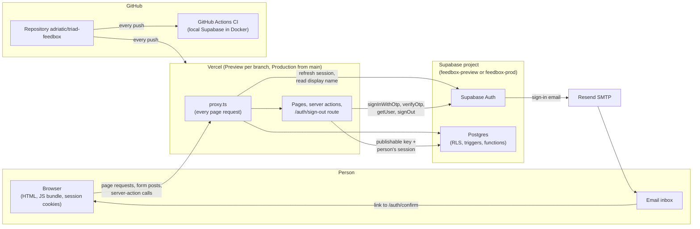

# Feedbox architecture

How the parts of Feedbox connect, written from the code at commit `1a13023` (tag `f5`, task A1).

Every statement names the file it comes from, so it can be checked line by line. Line numbers refer to `1a13023`. Two short names are used throughout:

- **the migration** means `supabase/migrations/20261113000000_feedbox_v1.sql`;
- **data.ts** means `lib/supabase/data.ts`.

If this file and the code disagree, the code is right and this file has a fault. CLAUDE.md requires every task that changes how the parts connect to update this file in the same pull request.

## Contents

1. [The parts](#1-the-parts)
2. [Who talks to whom](#2-who-talks-to-whom)
3. [The paths](#3-the-paths)
4. [Keys: which key is used where](#4-keys-which-key-is-used-where)
5. [Rules that hold everywhere](#5-rules-that-hold-everywhere)
6. [Where settings live](#6-where-settings-live)
7. [Not built yet, and open decisions](#7-not-built-yet-and-open-decisions)

## 1. The parts

### 1.1 The visitor's browser

- **What it gets:** the HTML that the app's server renders, and the app's JavaScript bundle.
- **No Supabase client:** the browser talks only to the app; it never calls Supabase itself.
  - No component imports a Supabase client. The files that use Supabase are all server code: `app/**/page.tsx`, `app/**/actions.ts`, `app/auth/sign-out/route.ts`, `proxy.ts` and data.ts. `app/ideas/new/PostIdeaForm.tsx:14` and `components/Header.tsx:5` import only TypeScript types from data.ts, and types are removed at build time.
  - The browser client `lib/supabase/browser.ts` was deleted in task F5b.
  - A build of this code (A1, 2026-11-18) has no Supabase address, no key and no Supabase client in `.next/static/`, the files sent to the browser.
- **Browser code that does work** (the `"use client"` files):
  - The vote button: `components/VoteButton.tsx`, `components/useVote.ts`.
  - The search box: `components/SearchBox.tsx`.
  - The sort menu: `components/SortMenu.tsx`.
  - The forms: `app/ideas/new/PostIdeaForm.tsx`, `app/ideas/[id]/CommentForm.tsx`, `app/sign-in/SignInForm.tsx`, `app/auth/confirm/ConfirmForm.tsx`, `app/welcome/WelcomeForm.tsx`.
  - The header and footer, which know the current page: `components/Header.tsx`, `components/Footer.tsx`.
  - Dates: `components/LocalDate.tsx`.
- **What it keeps:** only the session cookies that the server sets (see 3.7).

### 1.2 The Next.js app (on Vercel)

Next.js 16, App Router (`package.json`). It has five kinds of server code:

| Kind | Files | What it does |
|---|---|---|
| Pages (server components) | `app/page.tsx` (the board), `app/ideas/[id]/page.tsx`, `app/ideas/new/page.tsx`, `app/changelog/page.tsx`, `app/changelog/new/page.tsx`, `app/sign-in/page.tsx`, `app/auth/confirm/page.tsx`, `app/welcome/page.tsx`, `app/not-found.tsx`, `app/layout.tsx` | Read from Supabase on the server and render HTML |
| Server actions (`"use server"`) | `app/ideas/new/actions.ts` (`postIdea`, `findSimilar`), `app/ideas/[id]/actions.ts` (`addComment`), `components/vote-action.ts` (`vote`), `app/sign-in/actions.ts` (`sendLink`), `app/auth/confirm/actions.ts` (`finishSignIn`), `app/welcome/actions.ts` (`saveDisplayName`) | Called by the browser's forms and buttons; they run on the server and call Supabase |
| Route handler | `app/auth/sign-out/route.ts` | `POST` signs out; `GET` answers 405 |
| Proxy (Next.js 16's name for middleware) | `proxy.ts` | Runs before every page request: refreshes the session cookies and sends a person without a display name to /welcome |
| Server-side Supabase access | `lib/supabase/server.ts` (the client), data.ts (all reads, and the vote write), `lib/supabase/env.ts` (settings), `lib/supabase/site.ts` (the site's own address) | The only way the app reaches Supabase |

**The core library:** `lib/feedbox/` is pure TypeScript with no Supabase or Next.js imports (CLAUDE.md, Layout). It holds the rules the screens share: permissions, validation, sorting, tab counts, the vote button's states, date formats and the changelog grouping. Its unit tests sit beside the code (`lib/feedbox/*.test.ts`).

**One board per deployment:** a deployment shows one board, named by the setting `FEEDBOX_BOARD_SLUG` (`lib/supabase/env.ts:22-25`). It is read with `getBoard()` (data.ts:15-24).

### 1.3 Supabase

Each hosted project has two parts the app uses: Postgres and Supabase Auth.

**Postgres.** Everything is created by the migration.

- **Eight tables** (migration lines 36-148): `boards`, `profiles`, `board_owners`, `ideas`, `votes`, `comments`, `changelog_entries`, `changelog_items`.
- **Row-level security (RLS):** it is on for every table (lines 804-811), with policies at lines 813-928. The grants first revoke everything from `anon` and `authenticated` and then grant back only what is needed, column by column for writes (lines 726-797).
- **Functions the app may call:**
  - `is_board_owner` (lines 172-185);
  - `has_display_name` (lines 190-203);
  - `similar_ideas` (lines 687-717);
  - the owner functions `set_idea_status`, `merge_ideas`, `hide_idea`, `unhide_idea`, `hide_comment`, `unhide_comment` and `publish_changelog_entry` (lines 463-677).

  Today the app calls only `is_board_owner` (data.ts:44) and `similar_ideas` (data.ts:173, 199). The owner functions wait for F6.
- **Triggers** (lines 235-453):
  - a profile for every new user (5a);
  - rate limits of 5 ideas, 30 comments and 100 votes per person per hour (5b);
  - the idea timestamps, and "an idea in the changelog stays Shipped" (5c);
  - posting an idea casts the author's vote (5d);
  - `vote_count` follows `votes` (5e);
  - `comment_count` counts visible comments (5f);
  - changelog lines must name a Shipped idea of the same board (5g).
- **Helpers in the schema `private`**, which the API does not expose (lines 24-26, 755): `recent_count` and the trigger functions.
- **Project marker:** each project also has a row in `triad.project` that names it (CLAUDE.md, "SQL is code"; `supabase/marker/*.sql`). Only the check scripts and changing scripts read it; the app never does.

**Supabase Auth.**

- **Sign-in:** by email link only. The app asks for a link with `signInWithOtp` (`app/sign-in/actions.ts:26-29`) and redeems it with `verifyOtp` (`app/auth/confirm/actions.ts:23`).
- **Email templates:** the two templates are files in this repository (`supabase/templates/confirmation.html`, `supabase/templates/magic_link.html`). Nik pastes them into each hosted project (CLAUDE.md, "Sign-in emails").
- **Users and profiles:** users live in `auth.users`. A trigger gives each new user a row in `public.profiles` with no display name (migration lines 236-250). A profile never holds an email address (comment at line 45; `supabase/tests/01_structure.sql`, "no emails").

### 1.4 Resend

- **Who sends:** Supabase Auth sends the sign-in emails through Resend's SMTP server, `smtp.resend.com`, port 465, from `Feedbox <feedbox@pactresearch.net>`.
- **Where that is set:** each hosted project's dashboard (CLAUDE.md, "Sign-in by email"). It is not in this repository, and the app never talks to Resend.
- **Locally:** Mailpit catches every email instead, and nothing is sent (`supabase/config.toml:111-121`).

### 1.5 Vercel: Preview and Production

| | Preview | Production |
|---|---|---|
| Built from | every pushed branch | `main` |
| Address | `https://triad-feedbox-git-<branch>-nikolaj-ivancics-projects.vercel.app` | https://triad-feedbox-delta.vercel.app |
| Supabase project | `feedbox-preview` | `feedbox-prod` |
| Board (`FEEDBOX_BOARD_SLUG`) | `lumen` (from `supabase/seed.sql`) | `feedbox` (from `supabase/production/board-feedbox.sql`) |
| `NEXT_PUBLIC_SITE_URL` | not set; the email link returns to the address in use (`lib/supabase/site.ts:9-17`) | `https://triad-feedbox-delta.vercel.app` |
| Who can open it | Vercel sign-in needed (Standard Protection) | public |

Source: CLAUDE.md, "Vercel". The values themselves live only in Vercel.

### 1.6 GitHub

- **Repository:** `adriatic/triad-feedbox`. Work happens on one branch per task, with one pull request into `main`. Merges happen only in a merge task (CLAUDE.md, "Branches, pull requests and merging").
- **CI:** the workflow `.github/workflows/ci.yml` runs on every push and every pull request. Its five jobs:
  - `lint`, `typecheck` and `unit`;
  - `db`: a local Supabase database in Docker on the runner; pgTAP tests in `supabase/tests/`, then `npm run test:checks`;
  - `e2e`: the local Supabase stack in Docker, the app built and started on `127.0.0.1:3000`, then Playwright.
- **Required checks:** `main` requires those five plus Vercel's own status, `Vercel` (CLAUDE.md, item 2 of the branch rules; `scripts/triad-ready.sh` checks this).
- **CI uses no hosted project and no secret:** `ci.yml` has no `secrets.` line (see 4).
- **Reports:** the branch `cc-reports` holds the task reports. It is never merged into `main` (CLAUDE.md, "Reports").

### 1.7 The local setup (Nik's Mac and the CI runner)

- **Local Supabase:** the Supabase CLI runs it in Docker (colima on the Mac). Its settings are in `supabase/config.toml`: API on port 55421 and database on 55422 (lines 14 and 38), Mailpit for email.
  - `npm run db:start` starts the database only.
  - `npm run e2e:supabase` starts the full stack the end-to-end tests need (CLAUDE.md, Commands).
- **Playwright:**
  - The config (`playwright.config.ts`) builds the app and starts it on `http://127.0.0.1:3000`, with the local URL, the local publishable key and `FEEDBOX_BOARD_SLUG=lumen` (lines 25-35).
  - Tests run in the time zone `America/Los_Angeles` (line 23).
  - `e2e/local-supabase.ts:26-28` refuses any Supabase address other than `127.0.0.1`.
- **Mirrored sign-in settings:** the local stack mirrors the hosted sign-in settings except where a difference is on purpose (CLAUDE.md, "Local Supabase against these settings").

## 2. Who talks to whom

**The same picture in words:**

1. The browser talks only to the app on Vercel: page requests, form posts and server-action calls. It never talks to Supabase.
2. On every page request, `proxy.ts` runs first. It asks Supabase Auth who the person is, which also refreshes the session, and for a signed-in person it reads the display name from Postgres.
3. The pages, server actions and the sign-out route talk to Supabase:
   - to Postgres, with the publishable key and the person's session, so row-level security decides what each person may read and write;
   - to Supabase Auth, to send a link, redeem it, check who is signed in, and sign out.
4. Supabase Auth sends the sign-in email through Resend. The person opens the link from the inbox, and it leads back to the app's `/auth/confirm`.
5. Every push to GitHub starts CI on GitHub Actions, which uses only a local Supabase in Docker. It also starts a Vercel build: a Preview for a branch, Production for `main`.

## 3. The paths

### 3.1 Reading the board (`/`)

1. The browser asks for `/`, perhaps with `?tab=`, `?sort=new` or `?q=`.
2. `proxy.ts` refreshes the session (3.7) and lets the request through.
3. `app/layout.tsx:27-28` reads the board (`getBoard`, data.ts:15-24) and the viewer (`getViewer`, data.ts:35-49).
   - The viewer is "visitor" without a user, "owner" when `is_board_owner` says so, and "member" otherwise.
   - Both reads are cached for the request (`cache`, data.ts:15 and 35), so the page reuses them.
4. `app/page.tsx:37` reads every idea of the board that RLS lets this viewer see (`getIdeas`, data.ts:87-92).
   - The policy `ideas_read` lets anyone read ideas that are not hidden; owners also read hidden ones (migration lines 836-838).
5. The page picks the tab and the order in `lib/feedbox/list.ts`:
   - `ideasForTab` and `tabCounts` (lines 38-60);
   - merged ideas are never listed, and hidden ideas only for owners (`isListed`, lines 16-19);
   - "Most votes" means most votes first, then newest; "Newest" means newest first (lines 26-35).
6. It reads which of the shown ideas this person has voted for (`getMyVotes`, data.ts:154-164). The policy `votes_read_own` lets a person read only their own votes (migration lines 846-848).
7. The server renders the HTML.
   - The current tab is plain text, not a link (`app/page.tsx:60-71`).
   - The sort menu keeps the order in the address (`components/SortMenu.tsx`).

### 3.2 Searching (the board's search box)

1. The person types in **Search ideas**. `components/SearchBox.tsx:17-24` waits 300 ms after the last keystroke (`SIMILAR_DEBOUNCE_MS`, `lib/feedbox/screens.ts:12`), then changes the address to `?q=…` with `router.replace`.
   - Without JavaScript, Return submits the same address as a plain GET (line 27).
2. The server renders the board again (3.1). With 3 or more characters (`isSearchable`, `lib/feedbox/screens.ts:25-27`), `searchIdeaIds` calls `similar_ideas` on the server with the details included and at most 20 results (data.ts:170-181; `SEARCH_LIMIT`, screens.ts:17).
3. `similar_ideas` (migration lines 687-717) runs with the caller's own rights (`security invoker`). It:
   - scores word similarity on the title and, here, on the details;
   - keeps scores of 0.3 or more;
   - leaves out merged and hidden ideas;
   - orders by score, then votes.
4. The page shows the ideas of the current tab that are among those matches (`app/page.tsx:40-43`). The limit of 20 applies to the whole board, before the tab is chosen, so when more than 20 ideas on the board match, a tab can show fewer matches than it has. With fewer than 3 characters it says "Type at least 3 characters to search." (line 79).

### 3.3 Similar ideas while typing a title (Post an idea)

1. On `/ideas/new` the person types a title. `app/ideas/new/PostIdeaForm.tsx:33-58` waits 300 ms after the last keystroke, once the title has 3 or more characters.
2. The browser calls the server action `findSimilar(text)` (`app/ideas/new/actions.ts:45-55`). It is a request to the app's own server, not to Supabase. Task F5b moved it there: before F5b the browser asked Supabase directly, and on the Preview that showed nothing.
3. On the server, `findSimilar` reads the board and the viewer, then calls `getSimilarIdeas` (data.ts:196-208). That runs `similar_ideas` on titles only, with at most 5 results (`SIMILAR_LIMIT`, `lib/feedbox/screens.ts:15`), and marks the ideas this person has voted for (`getMyVotes`).
4. The result goes back to the browser, which lists the ideas, each with its own vote button (`PostIdeaForm.tsx:124-128` and `SimilarIdea` from line 135, which uses the same `useVote` as the board).
   - If the lookup fails, the form shows "Similar ideas could not be loaded just now. Check the ideas on the board before posting." (`actions.ts:51-53`; `PostIdeaForm.tsx:45-49`). It does not show an empty list.
5. Return in **Title** moves to **Details**; it does not post (`PostIdeaForm.tsx:79-85`, task F5b).

### 3.4 Posting an idea

1. A visitor who opens `/ideas/new` is sent to `/sign-in?next=%2Fideas%2Fnew` (`app/ideas/new/page.tsx:10`). A person without a display name never gets this far, because `proxy.ts` sends them to /welcome first (3.7).
2. **Post idea** submits the form to the server action `postIdea` (`app/ideas/new/actions.ts:15-36`).
3. The action checks the title and details with the core library (`validateTitle`, `validateBody` in `lib/feedbox/validation.ts`). It then checks that the person is signed in, and inserts `board_id`, `title` and `body` (lines 29-33).
4. The database checks everything again:
   - **Grant:** only those three columns may be written (migration line 771). The author is `auth.uid()` by default (line 73).
   - **Policy `ideas_insert_own`:** the author must be the person and must have a display name (lines 839-841).
   - **Checks on the table:** the title is 4 to 120 characters on one line, and the details at most 4000 (lines 86-91).
   - **Rate limit:** at most 5 ideas an hour (lines 292-294).
5. Triggers then:
   - set the timestamps (5c);
   - cast the author's own vote (5d, lines 361-377), so a new idea starts with 1 vote;
   - raise `vote_count` (5e).
6. The action redirects to `/ideas/<id>` (line 35). A refusal comes back to the form in words (`refusalMessage`, `lib/feedbox/screens.ts:83`).

### 3.5 Voting and unvoting

1. A visitor's vote button is a link to `/sign-in?next=<this page>` (`components/VoteButton.tsx:49-56`).
2. For a signed-in person, a click shows the change at once (`components/useVote.ts:20-38`; the states are in `lib/feedbox/votes.ts`). A second click while the first is still being sent is ignored (`useVote.ts:17-18, 40-48`).
3. The browser calls the server action `vote(ideaId, want)` (`components/vote-action.ts:9-11`). It is a request to the app's own server, not to Supabase. Task F5b moved it there.
4. On the server, `setMyVote` (data.ts:218-237) checks the session.
   - **Vote:** it inserts `{ idea_id }`; the voter is `auth.uid()` by default (migration line 100).
   - **Unvote:** it deletes the person's own row (data.ts:224-226).
5. The database decides:
   - **One vote:** the primary key `(idea_id, user_id)` allows one vote per person per idea (migration lines 98-103). A second vote fails with code 23505, which `setMyVote` ignores (`isDuplicateVote`, `lib/feedbox/screens.ts:78-80`). So a double click or a second tab never counts twice.
   - **Who may vote:** the policy `votes_insert_own` requires the person's own vote, a display name, and an idea that is not hidden and not merged (lines 849-858).
   - **Unvoting:** `votes_delete_own` lets a person remove only their own vote (lines 859-861).
   - **The count:** the rate limit allows 100 votes an hour (5b), and `vote_count` follows the `votes` table (5e).
6. `setMyVote` then reads the new count and the person's own vote back from the database (data.ts:230-236). The button shows those values, so the database is the authority. A failure is shown in words under the button (`VoteButton.tsx:71-75`).

### 3.6 Commenting

1. On `/ideas/<id>`, a signed-in person with a display name sees the comment box if the idea is not hidden (`app/ideas/[id]/page.tsx:31, 84-85`). A visitor sees **Sign in to comment** (lines 86-91).
2. **Post comment** calls the server action `addComment` (`app/ideas/[id]/actions.ts:13-27`). It checks the text with `validateComment`, checks the session, and inserts `{ idea_id, body }`.
3. The database checks:
   - **Grant:** only those two columns (migration line 774).
   - **Policy `comments_insert_own`:** the author's own comment, a display name, and an idea that is not hidden and not merged (lines 875-884).
   - **Text:** 1 to 2000 characters (lines 115-117).
   - **Rate limit:** 30 comments an hour (5b).
   - **Count:** a trigger keeps `comment_count` (5f).
4. The action refreshes the idea page (`revalidatePath`, line 25). The comments are listed oldest first, flat (data.ts:118-136).
5. The **Owner** mark appears next to a comment only when the viewer may read who the owners are (data.ts:138-151). See 3.10 and decision F5-D1.

### 3.7 Signing in by email link

**Ask for a link:**

1. On `/sign-in`, the person enters an email address and presses **Send me a link**. The server action `sendLink` (`app/sign-in/actions.ts:17-40`):
   - checks the address's form;
   - makes the return address `<site>/auth/confirm?next=<path>`, where `<site>` comes from `siteOrigin()` (`lib/supabase/site.ts:9-17`) and `<path>` is made safe by `safeNextPath` (`lib/feedbox/next-path.ts:9-27`), which never points back to /sign-in or /auth/;
   - calls `signInWithOtp` with `shouldCreateUser: true`.
2. Supabase Auth sends one of two emails through Resend (1.4):
   - **"Your first Feedbox sign-in link"** (Confirm signup) on a person's first sign-in;
   - **"Your Feedbox sign-in link"** (Magic Link) on every later sign-in.

   In both, the link is `{{ .RedirectTo }}&token_hash={{ .TokenHash }}&type=email` (`supabase/templates/*.html:3`), so it leads to the app's `/auth/confirm`, never through supabase.co (CLAUDE.md, "Sign-in emails").
3. If too many emails were sent, the form says so in words (`actions.ts:34-35`).

**Use the link:**

4. Opening the link shows `/auth/confirm` with a **Finish signing in** button (`app/auth/confirm/page.tsx`, `ConfirmForm.tsx`).
   - **The page does not sign in on load.** A mail scanner that opens the link in advance therefore cannot use it up (`app/auth/confirm/page.tsx:9`; `actions.ts:9-13`).
   - The page is not indexed and sends no referrer (`page.tsx:7`).
5. Pressing the button runs the server action `finishSignIn` (`app/auth/confirm/actions.ts:14-34`).
   - It accepts only `type=email`, calls `verifyOtp({ type: "email", token_hash })`, and on success Supabase sets the session cookies.
   - It then goes to `next`, or to `/welcome?next=…` when the person has no display name yet (line 33).
   - A used or expired link gives "This sign-in link has expired or was already used. Ask for a new one."

**Choose a name (first sign-in):**

6. `/welcome` asks for the display name once (`app/welcome/page.tsx`, `WelcomeForm.tsx`). The server action `saveDisplayName` (`app/welcome/actions.ts:10-22`) checks it with `validateDisplayName` and updates `profiles.display_name`.
   - The database allows the person to update only that column (migration line 770) and only their own row (lines 823-826).
   - The table's check requires 2 to 40 characters, no "@", and single spaces (lines 51-59).
7. **No name, no other page:** until the name is set, `proxy.ts:39-50` sends every page request except `/welcome` and `/auth/…` to `/welcome?next=<that page>`.

**Session cookies and their refresh:**

8. The session lives in cookies that `@supabase/ssr` sets (`lib/supabase/server.ts:6-9`).
   - On every page request, `proxy.ts:17-36` creates a server client with the request's cookies and calls `supabase.auth.getUser()`. That call asks Supabase Auth and refreshes an expired session.
   - New cookies are written onto the request and onto the response (lines 25-29), and onto a redirect too (line 48).
   - Server components cannot set cookies; `server.ts:18-23` relies on the proxy having refreshed them already.
   - Every "who is this?" in the app uses `getUser()`, which asks the Auth server, so a tampered cookie is not trusted (data.ts:30-37).
   - Locally, an access token lasts 3600 s and refresh tokens rotate (`supabase/config.toml:173, 179-182`). The hosted values live in the Supabase dashboard.

### 3.8 Signing out

1. **Sign out** in the header is a form that POSTs to `/auth/sign-out` (`components/Header.tsx:59-63`).
2. `app/auth/sign-out/route.ts:5-9` calls `signOut({ scope: "local" })`, which signs out this device only, and redirects to `/` with status 303.
3. A `GET` to `/auth/sign-out` answers 405, so a link or a prefetch cannot sign anyone out (lines 11-13; `e2e/auth.spec.ts:218-219`).

### 3.9 The changelog (`/changelog`)

1. `app/changelog/page.tsx:16` reads the changelog (`getChangelog`, data.ts:250-272) and the board's ideas.
   - **Entries:** the policy `changelog_entries_read` shows published entries to everyone, and drafts only to owners (migration lines 888-890).
   - **Lines:** they are readable when their entry is (lines 904-906).
2. `publishedChangelog` (`lib/feedbox/changelog.ts:23-50`) keeps only published entries and orders them newest release first. It drops lines whose idea is hidden and entries left with no lines.
3. Each release date is a calendar date, shown as written in any time zone (`formatDate`, `lib/feedbox/format.ts:26-31`).
4. Each line links to its idea. On /changelog the header reads "<board> Changelog" with **Back to the board**, and neither the header nor the footer links to /changelog (`components/Header.tsx:19-55`, `components/Footer.tsx:10-21`).
5. `/changelog/new` is a bare page for owners that lists drafts. The editor arrives in F6 (`app/changelog/new/page.tsx`).

### 3.10 What an owner sees today

1. **Who is an owner:** a person listed in `board_owners` for this board. Rows are added by reviewed SQL only, for example `supabase/production/owner-nik.sql`; there is no insert policy (migration lines 828-832). `getViewer` calls `is_board_owner` (data.ts:43-46).
2. **The header** reads "Signed in as owner" (`viewerStateLabel`, `lib/feedbox/permissions.ts:49-53`).
3. **Hidden ideas and comments:** an owner also sees them, marked "Hidden" (`app/page.tsx:36, 99`; `app/ideas/[id]/page.tsx:30, 51, 74`).
   - RLS lets owners read them (migration lines 836-838, 866-874).
   - Search and similar ideas still leave hidden ideas out (`similar_ideas`, line 713).
4. **The Owner mark:** an owner sees **Owner** next to comments written by any owner of the board. The policy `board_owners_read` lets an owner read all owners of the board; anyone else reads at most their own row (migration lines 830-832; data.ts:138-151).
   - So visitors and members never see the mark. This is decision F5-D1.
5. **No owner tools in the app yet:** the database already has the owner functions (status, merge, hide and unhide, publish), but no page calls them. They arrive in F6.

## 4. Keys: which key is used where

| Key | Where it is used | Where it lives |
|---|---|---|
| Publishable key of feedbox-preview or feedbox-prod (`sb_publishable_…`) | The app's server only: `lib/supabase/server.ts:12`, `proxy.ts:17-19`, read through `lib/supabase/env.ts:18-20` | Vercel setting `NEXT_PUBLIC_SUPABASE_PUBLISHABLE_KEY`, per environment (CLAUDE.md, "App settings on Vercel") |
| Secret key of either hosted project | **Nowhere in the app, CI or the Mac.** No file reads one (`lib/supabase/env.ts:4-5`: "Only the publishable key is ever read") | Only in the Supabase dashboard, plus the GitHub Actions secret below |
| Local development keys (publishable and secret) of the Supabase stack in Docker | Playwright and the e2e helpers, read at run time from `npx supabase status` and never written to a file (`e2e/local-supabase.ts:1-4`). The local secret key is used only by `e2e/helpers.ts:11-13`, to make sign-in links without email, set up a state, and tidy up | Printed by the local stack; valid only at 127.0.0.1 |
| Resend API keys `feedbox-preview` and `feedbox-prod` | Supabase Auth's SMTP password, one key per project | Only in Supabase and Resend (CLAUDE.md, Resend) |
| GitHub Actions secrets `SUPABASE_PREVIEW_URL`, `SUPABASE_PREVIEW_PUBLISHABLE_KEY`, `SUPABASE_PREVIEW_SECRET_KEY` (created 2026-11-13) | **Nothing uses them.** `.github/workflows/ci.yml` has no `secrets.` line, and no commit on any branch ever used them in a workflow | GitHub, repository settings (names seen with `gh secret list`; values never read) |

**About the `NEXT_PUBLIC_` names:**

- Next.js copies `NEXT_PUBLIC_` values into browser code that reads them.
- Since F5b, no browser code reads the Supabase URL or key, so they stay on the server. A build of this code has neither in `.next/static/` (1.1).
- The names were kept so that the Vercel settings did not have to change.

## 5. Rules that hold everywhere

Each rule names the test or check that guards it.

| # | Never… | Guarded by |
|---|---|---|
| 1 | The browser never calls Supabase itself; every read and write goes through the app's server | `e2e/screens.spec.ts:11-26`: every test in that file aborts and records any browser request to the local Supabase API, and fails if there was one (task F5b). `lib/supabase/env.test.ts:31` checks that only `env.ts` reads the Supabase settings |
| 2 | No secret key in the app, on the Mac or in a commit | CLAUDE.md, "Three rules" 1 and 3; `.gitignore` excludes every `.env*`; `e2e/local-supabase.ts:26-28` refuses any Supabase address but 127.0.0.1 |
| 3 | A table never goes without row-level security, and anon and authenticated never get more than the listed grants | `supabase/tests/01_structure.sql`: RLS on every table, exact table and column privileges, and `search_path=''` on every security definer function |
| 4 | Never more than one vote per person per idea | The primary key on `votes` (migration lines 98-103); `supabase/tests/04_votes.sql` (a second vote fails with 23505; nobody votes as someone else); `e2e/screens.spec.ts:288` (a double click, a reload and a second insert through the API give one vote) |
| 5 | Nobody writes `vote_count`, `comment_count`, `status`, `hidden_at` or `published_at` directly | Column grants (migration lines 767-780) and triggers 5c-5f; `supabase/tests/03_ideas.sql` ("what nobody may write directly"); `supabase/tests/01_structure.sql` |
| 6 | Nobody votes, posts or comments without a display name | Policies with `has_display_name()` (migration lines 839-841, 849-858, 875-884); `proxy.ts:39-50`; `e2e/auth.spec.ts:40` (step 4: nothing else can be done before the name is set) |
| 7 | A person never exceeds 5 ideas, 30 comments or 100 votes an hour | Trigger 5b (migration lines 257-300); `supabase/tests/09_rate_limits.sql`; `e2e/screens.spec.ts:327` (the refusal in words) |
| 8 | `/auth/confirm` never signs in on page load | `app/auth/confirm/actions.ts:9-13`; `e2e/auth.spec.ts:47-52` and `145-151` (after opening the link the header still reads "Viewing as visitor") |
| 9 | A sign-in link never goes through supabase.co (`{{ .ConfirmationURL }}`) | `tests/email-templates.test.ts`; CLAUDE.md, "Sign-in emails" |
| 10 | `next` never leads off the site, or back into /sign-in or /auth/ | `safeNextPath` (`lib/feedbox/next-path.ts:9-27`); `lib/feedbox/next-path.test.ts` |
| 11 | Sign-out never happens on a GET | `app/auth/sign-out/route.ts:11-13`; `e2e/auth.spec.ts:218-219` (405) |
| 12 | A moment is never shown in the server's time zone; a calendar date is never shifted | `components/LocalDate.tsx`; `lib/feedbox/format.ts`; `lib/feedbox/format.test.ts`; `e2e/screens.spec.ts:390` (a post at 5:04 PM Pacific on Nov 17 reads Nov 17 in Los Angeles and Nov 18 in UTC and Berlin) |
| 13 | No link leads to the page you are on: header, footer, the current tab, the ticked sort order | `e2e/screens.spec.ts:145` (header, task F5c) and `:172` (footer, tabs, sort menu, and every visitor page checked for links to its own address, task F5d) |
| 14 | A profile never holds an email address, and a display name never contains "@" | `profiles` has no email column; check `profiles_display_name_check` (migration lines 53-59); `supabase/tests/01_structure.sql`; `e2e/auth.spec.ts:68` |
| 15 | A migration is never edited after it ran on feedbox-preview | `tests/sql-files.test.ts:68-74` pins the file's sha256 |
| 16 | The tests never touch a hosted project | `e2e/local-supabase.ts:26-28`; `ci.yml` (no secrets; local Supabase only); CLAUDE.md, "Three rules" 2 |

## 6. Where settings live

- **Dashboard settings** (Vercel, Supabase Auth, Resend): CLAUDE.md, section "Dashboard settings". It is the source of truth, records who checked each setting and when, and names secrets only by name. Values are not copied here.
- **The app's environment variables:**
  - `NEXT_PUBLIC_SUPABASE_URL`, `NEXT_PUBLIC_SUPABASE_PUBLISHABLE_KEY` and `FEEDBOX_BOARD_SLUG` are read only through `lib/supabase/env.ts`. A missing one fails with "Missing environment variable <NAME>" (`env.ts:9-12`; `lib/supabase/env.test.ts`).
  - `NEXT_PUBLIC_SITE_URL` is optional, read in `lib/supabase/site.ts:10`.
  - In Vercel they are set per environment (CLAUDE.md, "App settings on Vercel"). Locally and in CI they come from `npx supabase status` (`playwright.config.ts:30-34`).
- **Local Supabase settings:** `supabase/config.toml`. Where they differ from hosted, the difference is on purpose (CLAUDE.md, "Local Supabase against these settings").
- **SQL that Nik runs on a hosted project:** files in `supabase/checks/`, `supabase/marker/` and `supabase/production/`, each reviewed and tested (CLAUDE.md, "SQL is code").

## 7. Not built yet, and open decisions

**Not built yet (task F6):**
- The owner tools on the idea page: change status, merge, hide and unhide ideas and comments (`app/ideas/[id]/page.tsx:11`).
- The changelog editor (`app/changelog/new/page.tsx:5, 30`).

The database functions for all of these exist (migration lines 457-677) and are tested (`supabase/tests/06_owner_functions.sql`, `07_merge.sql`, `08_changelog.sql`).

**Open decisions** (from the F5 report; not repeated here):
- **F5-D1:** whether everyone may read who the board's owners are, so that the Owner mark shows for every viewer (see 3.10).
- **F5-D2:** whether to build an end-to-end runner against the hosted Preview (`playwright.config.ts:4-7`).
